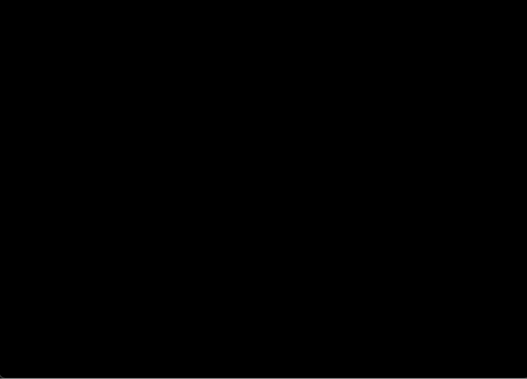

# Simple WFC

Simple wave function collapse implemented in Java. Generates textures from small tiles based on constraint rules, with real-time visualization of the algorithm stepping through each cell.



## How it Works

Each tile defines **ports** on its edges (north, south, east, west). Two tiles can sit next to each other only if their adjacent ports match. The algorithm picks the most constrained cell, collapses it to one tile, and propagates the constraints outward. This is repeated until the entire grid is filled. If it hits a dead end, it backtracks and tries a different choice.

Implemented: 
* Rotations in 2d
* Output texture tileability
* Backtracking

TODO:

* 3D
* Symmetries
* ...

## How to Run

```
./gradlew desktop:run
```

## Controls

| Key     | Action                    |
|---------|---------------------------|
| `Space` | Step one round (observe + propagate) |
| `1`     | Run to completion         |
| `o`     | Observe step only         |
| `p`     | Propagate step only       |
| `g`     | Print grid to console     |
| `c`     | Print constraints         |
| `r`     | Print rotations           |

## Tiled model — generate circuit texture
  ./gradlew core:generate --args="tiled assets --basename circ --tiling --seed 229 --output circuit.png"

## Tiled model — your own tileset (JSON)
  ./gradlew core:generate --args="tiled assets/circuit.json --seed 229 --output circuit.png"

Tile images are `{basename}{id}.png` next to the JSON. Tile ID 0 is empty when `emptyAllowed` is true. See [assets/circuit.json](assets/circuit.json):

```json
{
  "name": "Circuit", "basename": "circ", "tileCount": 9,
  "emptyAllowed": true, "rotationsAllowed": true,
  "tilePixelW": 32, "tilePixelH": 32,
  "weights": { "0": 3.0, "1": 0.3 },
  "ports": [ { "tile": 1, "dir": "N", "port": 1 }, ... ]
}
```

`weights` sets how often each tile ID is picked (default 1, 0 = only when nothing else fits). It is an object keyed by tile ID or an array indexed by tile ID.

`tags` marks tile IDs with game properties: `"tags": { "walkable": [0, 2], "water": [5] }`. In a pipeline, `TilePropertyPass` turns the solved tile layer into a mask:

```java
pipeline
    .add(new WfcPass("terrain", def.tileCount, def.constraints).weights(def.weights))
    .add(TilePropertyPass.fromTag(def, "terrain", "walkable", "walkable"))
    .add(new ReachabilityCheckPass("walkable", 0, 0));
```

Tags are exported too: as boolean custom properties on Tiled tiles (`.tmx`/`.tmj`), and as a `tags` block in plain `.json`.

## Tiled map editor export
  ./gradlew core:generate --args="tiled assets/circuit.json --seed 229 --output maps/circuit.tmx"
  ./gradlew core:generate --args="tiled assets/circuit.json --count 10 --format tmj --output maps/"

The output extension (or `--format`) picks the format:

| Format | Content |
|--------|---------|
| `png`  | Rendered image |
| `tmx`  | Tiled map, XML. Opens in Tiled, loads with libGDX `TmxMapLoader`, Godot, Unity etc. |
| `tmj`  | Tiled map, JSON |
| `json` | Plain grid: `tiles` and `rotations` (quarter turns clockwise), row-major, top row first |

Tiled maps embed a tileset that points at the tile PNGs by a path relative to the map file. Rotations are stored as Tiled flip flags. The GUI export dialog offers the same formats in tiled mode.

## Overlapping model — generate texture from any sample image
  ./gradlew core:generate --args="overlapping sample.png --size 64x64 --tiling --output result.png"

## Batch — generate 10 variations
  ./gradlew core:generate --args="overlapping sample.png --size 64x64 --count 10 --seed 1 --output textures/"

## Test output:

### Circuits
Input tiles:

       

Output:


### Test:
Input tiles:

           

Output:


### Cross:
Input tiles:

   

Output:


### Some fun:


## Dependencies

Displaying is done using LibGDX